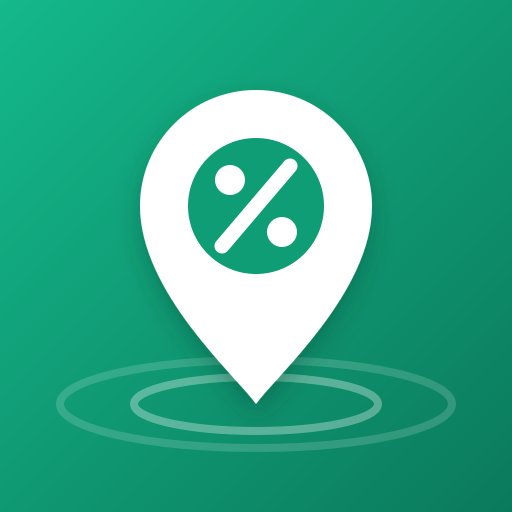
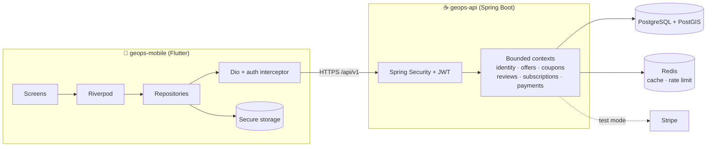

  

<h1 align="center">GeoPS</h1>

  <b>Ofertas y cupones hiperlocales</b> que conectan negocios locales con consumidores cercanos. 
  <i>Hyperlocal offers and coupons connecting local businesses with nearby consumers.</i>

  
  
  
  
  

---

### 🇪🇸 Qué es GeoPS

Un consumidor abre el mapa y ve ofertas de negocios **a pocos metros**: la bodega de la esquina, la panadería del barrio, el restaurante de la cuadra. Reclama un cupón, lo muestra en el local y el negocio lo canjea. Los negocios publican ofertas en minutos y ven cuántos canjes generan.

### 🇬🇧 What GeoPS is

A consumer opens the map and sees offers from businesses **a few meters away**: the corner store, the neighborhood bakery, the restaurant down the block. They claim a coupon, show it at the counter and the business redeems it. Businesses publish offers in minutes and see how many redemptions they get.

## Repositories

| Repo | Description | Stack |
|---|---|---|
| [**geops-api**](https://github.com/geops-app/geops-api) | REST API: auth, offers by radius, coupons, payments | Java 21 · Spring Boot 4 · PostgreSQL + PostGIS · Redis · Flyway |
| [**geops-mobile**](https://github.com/geops-app/geops-mobile) | App for consumers and businesses | Flutter · Riverpod · go_router · Dio · Clean Architecture |

## Architecture

## Roadmap

| Version | Scope | Status |
|---|---|---|
| **v0.1.0** | Foundation, CI, authentication with roles | ✅ Released |
| **v0.2.0** | Businesses, offers, map and geolocation | 🚧 Next |
| **v0.3.0** | Coupons, redemption, stats, deployment (**MVP**) | ⏳ Planned |
| Later | Favorites, reviews, cart, subscriptions, payments, notifications | ⏳ Planned |

## Engineering practices

- **Git flow**: `feature/*` → PR → `develop` → release PR → `main` + semantic tag. Protected branches with required CI.
- **Security by design**: BCrypt, short-lived JWT + rotated refresh tokens stored as hashes, rate limiting, restrictive CORS, secrets only in environment variables, Dependabot.
- **Testing**: JUnit 5 + Testcontainers (real PostGIS and Redis) in the API; unit, widget and flow tests in the app.

Built by <a href="https://github.com/IDymian">@IDymian</a>.
